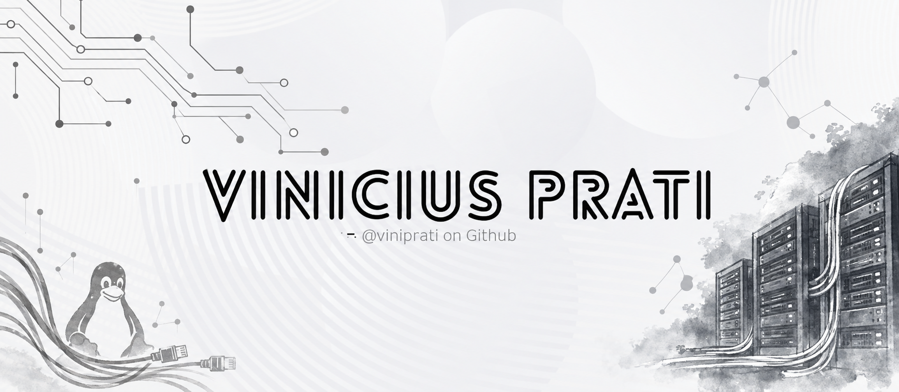
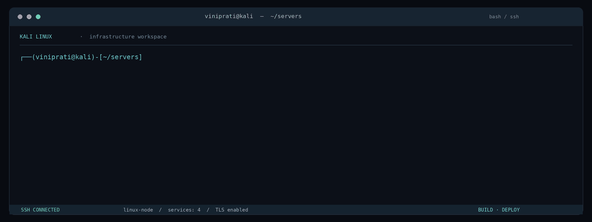

  

  <h1>Olá, eu sou Vinicius Prati</h1>
  <h3>Desenvolvedor Full Stack Web em formação</h3>

  Crio aplicações web, bots e APIs, além de configurar e administrar servidores Linux, com foco em código bem estruturado, automação e infraestrutura.

  <a href="https://www.viniprati.dev" target="_blank">
    <picture>
      <source media="(prefers-color-scheme: dark)" srcset="./assets/badges/portfolio-dark.svg">
      
    </picture>
  </a>
  <a href="https://g.dev/viniprati" target="_blank">
    <picture>
      <source media="(prefers-color-scheme: dark)" srcset="./assets/badges/google-developer-dark.svg">
      
    </picture>
  </a>
  <a href="https://linkedin.com/in/vinicius-prati-machado-b25206313" target="_blank">
    <picture>
      <source media="(prefers-color-scheme: dark)" srcset="./assets/badges/linkedin-dark.svg">
      
    </picture>
  </a>
  <a href="mailto:prativinicius@gmail.com" target="_blank">
    <picture>
      <source media="(prefers-color-scheme: dark)" srcset="./assets/badges/email-dark.svg">
      
    </picture>
  </a>

---

### Sobre mim

Sou desenvolvedor **Full Stack Web**, com foco em construir aplicações completas, organizadas e funcionais. Tenho estudado e praticado principalmente com **React**, **Node.js**, **TypeScript**, bancos de dados relacionais e bancos não relacionais.

Atualmente curso **Desenvolvimento de Sistemas para Internet** no **IFES**, onde venho fortalecendo minha base técnica e aplicando esse conhecimento em projetos práticos.

Também atuo como **Monitor de laboratório de informática** no **IFES Campus Santa Teresa**, com experiência em gestão de laboratórios, manutenção de computadores, instalação de software e apoio ao uso dos ambientes acadêmicos de tecnologia.

Meu objetivo é evoluir como desenvolvedor criando produtos web com boa experiência de uso, código bem estruturado e integração consistente entre frontend, backend e deploy.

---

### Linux e infraestrutura

Além do desenvolvimento web, tenho interesse em Linux, infraestrutura e deploy. Minha experiência como monitor de laboratório inclui manutenção de computadores, instalação de software e apoio técnico nos ambientes do IFES.

  

---

### Tecnologias e ferramentas

  
   
  
  
  
  
   
  

---

### Atividade no GitHub

<picture>
  <source media="(prefers-color-scheme: dark)" srcset="https://raw.githubusercontent.com/viniprati/viniprati/output/pacman-contribution-graph-dark.svg">
  <source media="(prefers-color-scheme: light)" srcset="https://raw.githubusercontent.com/viniprati/viniprati/output/pacman-contribution-graph.svg">
  
</picture>

---

### Contato

Fique à vontade para entrar em contato para trocar ideias, conversar sobre tecnologia ou conhecer melhor meus projetos.

- LinkedIn: [Vinicius Prati Machado](https://linkedin.com/in/vinicius-prati-machado-b25206313)
- Portfólio: [viniprati.dev](https://www.viniprati.dev)
- Google Developer: [g.dev/viniprati](https://g.dev/viniprati)
- Email: [prativinicius@gmail.com](mailto:prativinicius@gmail.com)
